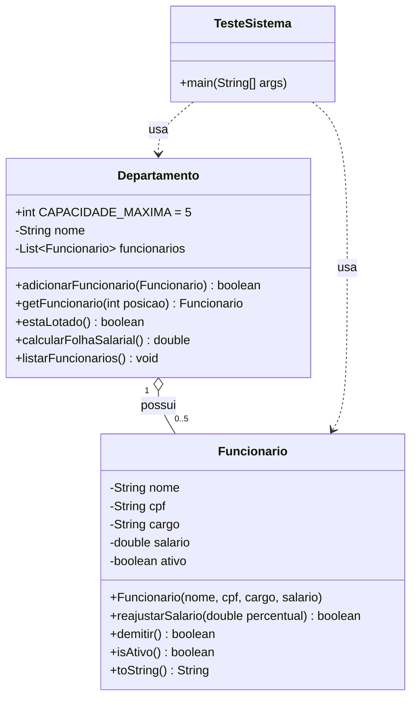

<div align="center">

# 👥 Sistema de Funcionários

**Sistema de console em Java para gerenciar os funcionários de um departamento: cadastro, listagem, folha salarial, reajuste e demissão.**


</div>

---

## 📑 Sumário

- [Sobre o projeto](#-sobre-o-projeto)
- [Funcionalidades](#-funcionalidades)
- [Estrutura do projeto](#-estrutura-do-projeto)
- [Modelo de classes](#-modelo-de-classes)
- [Como executar](#-como-executar)
- [Exemplo de uso](#-exemplo-de-uso)
- [Ideias de evolução](#-ideias-de-evolução)
- [Autor](#-autor)

---

## 📖 Sobre o projeto

O programa roda no terminal e mostra um menu interativo para gerenciar o **Departamento de TI**. Dá para cadastrar funcionários, listá-los, calcular a folha salarial e, depois de escolher um funcionário, reajustar o salário, demiti-lo ou ver os seus dados.

### Conceitos praticados

- ✅ **Encapsulamento**: atributos `private`, com getters e setters
- ✅ **Regras de negócio dentro das classes** (`demitir()`, `reajustarSalario()`, `calcularFolhaSalarial()`)
- ✅ **Coleções**: `ArrayList` para guardar os funcionários, exposta como lista somente leitura
- ✅ **Organização em pacotes** (`modelo`, `menu`, `util`)
- ✅ **Validação de entrada**: o programa não quebra se o usuário digitar algo inválido

---

## ✨ Funcionalidades

### Menu do departamento

| Opção | O que faz |
|-------|-----------|
| 1 | Cadastrar funcionário (nome, CPF, cargo e salário) |
| 2 | Listar os funcionários, com a situação de cada um |
| 3 | Mostrar a folha salarial (soma dos salários dos funcionários **ativos**) |
| 4 | Abrir o menu individual de um funcionário |
| 0 | Sair do sistema |

### Menu do funcionário

| Opção | O que faz |
|-------|-----------|
| 1 | Reajuste salarial, informando o percentual (ex.: `10` = +10%) |
| 2 | Demitir o funcionário |
| 3 | Exibir os dados do funcionário |
| 0 | Voltar ao menu do departamento |

### Regras do sistema

- Cada departamento aceita **no máximo 5 funcionários**.
- Funcionário **demitido** não recebe reajuste e **não entra na folha salarial**.
- O salário não pode ser negativo e o reajuste precisa ser maior que zero.
- Campos de texto não podem ficar vazios; números inválidos pedem nova digitação.
- O salário aceita vírgula ou ponto como separador decimal (`3000,50` ou `3000.50`).

---

## 📁 Estrutura do projeto

```
SistemaFuncionarios1/
├── src/
│   ├── TesteSistema.java              # Classe principal (main) e fluxo do programa
│   ├── modelo/                        # Regras de negócio
│   │   ├── Funcionario.java
│   │   └── Departamento.java
│   ├── menu/                          # Telas do console (só exibem e coletam dados)
│   │   ├── MenuDepartamento.java
│   │   ├── MenuFuncionario.java
│   │   └── CadastroFuncionario.java
│   └── util/                          # Ferramentas de apoio
│       ├── LeitorConsole.java         # Leitura do teclado com validação
│       └── Formatador.java            # Formatação de valores em reais
├── nbproject/                         # Configuração do projeto no NetBeans
├── build.xml                          # Script Ant (NetBeans)
├── manifest.mf
├── .gitignore
└── README.md
```

### Quem faz o quê

| Pacote | Responsabilidade |
|--------|------------------|
| `modelo` | Guarda os dados e as **regras** (o que um funcionário e um departamento fazem) |
| `menu` | Mostra os menus e pergunta os dados ao usuário |
| `util` | Funções reutilizáveis: ler o teclado e formatar dinheiro |
| `TesteSistema` | Liga tudo: chama os menus e usa as classes do `modelo` |

---

## 🧬 Modelo de classes



---

## 🚀 Como executar

### Pré-requisitos

- **JDK 8 ou superior** para compilar pelo terminal.
- O projeto NetBeans acompanha `javac.source`/`javac.target` definidos em `nbproject/project.properties` (hoje `26`). Se a sua JDK for mais antiga, ajuste esses dois valores para a versão instalada.

```bash
java -version
javac -version
```

### Pelo terminal

```bash
# 1. Clonar o repositório
git clone <url-do-seu-repositorio>
cd SistemaFuncionarios1

# 2. Compilar (os .class vão para a pasta out/)
javac -encoding UTF-8 -d out -sourcepath src src/TesteSistema.java

# 3. Executar
java -cp out TesteSistema
```

### Pelo NetBeans

1. Abra **File → Open Project** e selecione a pasta do projeto.
2. Clique com o botão direito no projeto e escolha **Run** (ou pressione `F6`).

### Pelo IntelliJ IDEA / VS Code

1. Abra a pasta do projeto.
2. Marque `src` como **Sources Root** (IntelliJ: botão direito → *Mark Directory as*).
3. Execute a classe `TesteSistema`.

---

## 🖥️ Exemplo de uso

```text
++++ SISTEMA DE GESTAO DE DEPARTAMENTO ++++
Departamento de TI
[1] Cadastrar funcionario
[2] Listar funcionarios
[3] Folha salarial
[4] Menu individual de funcionario
[0] Sair
Escolha: 1

++++++++++++++++++++
----- Cadastro -----
++++++++++++++++++++
Nome do funcionario: Ana Souza
CPF: 123.456.789-00
Cargo: Desenvolvedora
Salario: 5000
-> Ana Souza cadastrado com sucesso.
```

Listando e vendo a folha salarial:

```text
Escolha: 2
Departamento de TI:
  1. Funcionario: Ana Souza | CPF: 123.456.789-00 | Cargo: Desenvolvedora | Salario: R$ 5.000,00 | Situacao: Ativo
  2. Funcionario: Bruno Lima | CPF: 987.654.321-00 | Cargo: Analista | Salario: R$ 3.000,50 | Situacao: Ativo

Escolha: 3
Folha salarial: R$ 8.000,50
```

Menu individual (reajuste e demissão):

```text
Escolha: 4
Numero do funcionario: 1
Funcionario selecionado: Ana Souza

[1] Reajuste salarial  [2] Demitir  [3] Exibir dados  [0] Voltar
Escolha: 1
Digite o percentual de reajuste: 10
Ana Souza -> novo salario: R$ 5.500,00 (reajuste de 10.0%)
Escolha: 2
Ana Souza foi demitido.
Escolha: 1
Digite o percentual de reajuste: 5
Reajuste nao realizado (funcionario demitido ou percentual invalido).
```

Depois da demissão, a folha salarial passa a considerar só quem continua ativo (no exemplo acima: `R$ 3.000,50`).

---

## 🛠️ Ideias de evolução

- [ ] Permitir vários departamentos
- [ ] Impedir dois funcionários com o mesmo CPF e validar o formato do CPF
- [ ] Adicionar a opção de editar os dados de um funcionário
- [ ] Salvar os dados em arquivo para não perdê-los ao fechar o programa
- [ ] Escrever testes unitários com JUnit

---

## 👨‍💻 Autor

Feito por **Matheus Magri**.

Projeto desenvolvido para fins de estudo de Programação Orientada a Objetos em Java.
